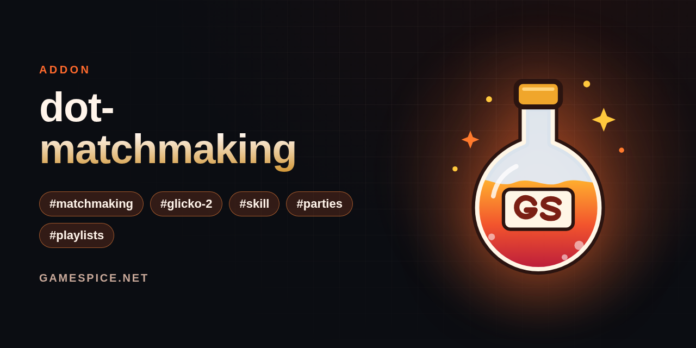

[](https://moddingcommunity.com/a/262-dot-matchmaking)

Skill-based matchmaking for a Godot 4 game. Players and parties queue, the queue finds a fair match in a region everyone can reach, everyone accepts, a server is found, and the result moves everybody's rating. It needs only [dot-core](https://github.com/gamespice-platform/core). Part of TMC's open source **Gamespice** collection (MIT licence).

> Built with Claude Code. Every addon has a headless test suite and the suites pass, but little of this has met real players yet. Please report rough edges.

## Install

Copy `addons/dot_matchmaking/` and dot-core's `addons/dot_core/` into your project and enable dot-matchmaking under **Project > Project Settings > Plugins**. dot-party is not needed (a party is a ticket with several ids on it), and dot-auth's client is used when present.

## Ratings: Glicko-2, one per queue

A single number treats a newcomer and a thousand-game veteran on the same number as the same player, and puts the newcomer against people who will flatten them for the twenty games it takes that number to move. Glicko-2 keeps three numbers: a rating, a deviation (how sure we are) and a volatility (how steady the player is). The deviation shrinks with every game and grows back with absence, so a newcomer or a returning player moves quickly and a regular moves slowly. The update is the published algorithm step for step, and the test suite checks it against the worked example in the Glicko-2 paper.

- **Team games.** Every player on a side sees the expectation that the two sides' averages predict, while how far each one moves depends on their own deviation. Rating each player against the other side's average would punish a strong player for weak team-mates.
- **One rating per queue.** Skill at two-a-side and at a twelve-player free-for-all are different facts. The number shown to players is the rating minus two deviations, so two lucky wins do not top a leaderboard.
- **Partial matches.** Someone who connected for the last minute is rated for a fraction of the match, and not at all below `min_participation`.
- **Leavers.** Someone who left a ranked match is rated as having lost it, fully (`leaver_takes_loss`). Otherwise leaving a losing match is free.

## The queue

```gdscript
var duel := DotMmPlaylist.of(&"duel", 2, 1)        # two sides of one
var fives := DotMmPlaylist.of(&"ranked5", 2, 5)
fives.max_party_size = 3                            # no full five-stacks against strangers

var mm := DotMatchmaker.new()
mm.playlists = [duel, fives]
mm.allocator = my_servers                           # anything with allocate(match)
add_child(mm)

mm.enqueue("t-81", &"ranked5", PackedStringArray(["ada", "bo"]), [{"eu": 31, "na": 110}, {"eu": 44}], party_id)
mm.match_found.connect(func(m, deadline): show_accept_prompt(m, deadline))
mm.match_ready.connect(func(m): send_everyone_to(m.allocation["address"]))
```

A playlist is one thing a player can queue for. The accepted skill gap, the latency ceiling and the minimum match quality all start strict and relax the longer someone waits. A single fixed tolerance either starves players at the top and bottom of the ladder or makes every match poor.

- **Oldest ticket first.** Each pass builds a match around whoever has waited longest, so nobody waits forever.
- **Region first.** A ticket is only considered for a region it can reach within its own latency ceiling. A long wait never hands a newcomer extra milliseconds.
- **Parties are never split.** A party is one ticket. Its latency is its worst member's, and its matching rating leans from the average toward its best player.
- **Balanced sides.** With two sides, up to `exhaustive_limit` tickets are split by trying every combination, which finds the best split. More tickets, or more than two sides, use a fast greedy search that moves whole parties. Both give the same answer for the same input.
- **Ratings come from the store, never from the client.**

## Accepting a match

A found match waits for everyone to accept. Someone who declines or does not answer is kept out of the queue for `decline_cooldown_sec`. Everyone else goes back in at the time they originally queued, so they are next rather than last. A party with one member who did not answer leaves together. A match with no free server falls through without punishing anyone.

## Settings

### Per queue (`DotMmPlaylist`)

| Setting | Default | What it does |
| --- | --- | --- |
| `teams`, `team_size` | 2, 5 | Number of sides and players per side. |
| `max_party_size` | 0 | Largest party allowed. 0 = up to a whole team. |
| `exhaustive_limit` | 16 | With two sides, the most tickets split by trying every combination. 0 = always try every combination (cost doubles per ticket, so only for small teams; past 63 tickets it logs an error and goes greedy). |
| `ranked` | true | Whether results move ratings. |
| `placement_games` | 10 | Matches before a rating is shown. |
| `skill_window` | 100.0 | Rating spread accepted at first. |
| `skill_window_growth` | 5.0 | Spread added per second waited. |
| `skill_window_max` | 800.0 | Widest the spread gets. |
| `min_quality` | 0.6 | Worst match accepted at first: 1 is a coin toss, 0 a foregone conclusion. |
| `min_quality_decay` | 0.004 | How much the quality bar drops per second waited. |
| `party_skill_blend` | 0.5 | 0 = a party rates as its average, 1 = as its best player. |
| `premade_bonus` | 20.0 | Rating added per party member beyond the first, because a premade coordinates. |
| `max_latency_ms` | 80 | Latency ceiling at first. |
| `latency_growth` | 2.0 | Milliseconds of extra tolerance per second waited. |
| `max_latency_cap_ms` | 180 | The ceiling never goes past this. |
| `accept_timeout_sec` | 20.0 | Seconds to accept a found match. 0 skips the step. |
| `decline_cooldown_sec` | 60.0 | Seconds out of the queue after declining. |

### Machinery (`DotMatchmakingConfig`)

Layered like every Gamespice config: defaults, JSON or `matchmaking.yml`, `DOT_MM_*` environment, `--mm-*` command line.

| Setting | Default | What it does |
| --- | --- | --- |
| `pass_interval_sec` | 1.0 | Seconds between queue passes. |
| `max_tickets` | 10000 | Tickets held across every queue. A new ticket is refused past this. 0 = unlimited. |
| `tau` | 0.5 | Glicko-2 system constant. Lower is steadier. |
| `inactivity_period_days` | 14.0 | Days idle that count as one rating period. |
| `ratings_file` | `user://matchmaking/ratings.json` | Where local ratings are kept. |
| `min_participation` | 0.25 | Participation below this is not rated. |
| `leaver_takes_loss` | true | A ranked leaver is rated as having lost. |

## The website

On TMC the website computes ratings, not the game server, because ratings decide who other people are made to play against. `DotMmBackbone` files the match result (sides, places, participation, leavers) and stores the ratings the website sends back. [docs/backbone-contract.md](docs/backbone-contract.md) lists the routes. Without them, and always on a self-hosted server, the matchmaker rates locally into a file.

## More

[docs/design.md](docs/design.md) explains the choices.

## Licence

MIT. See [LICENSE](LICENSE).
